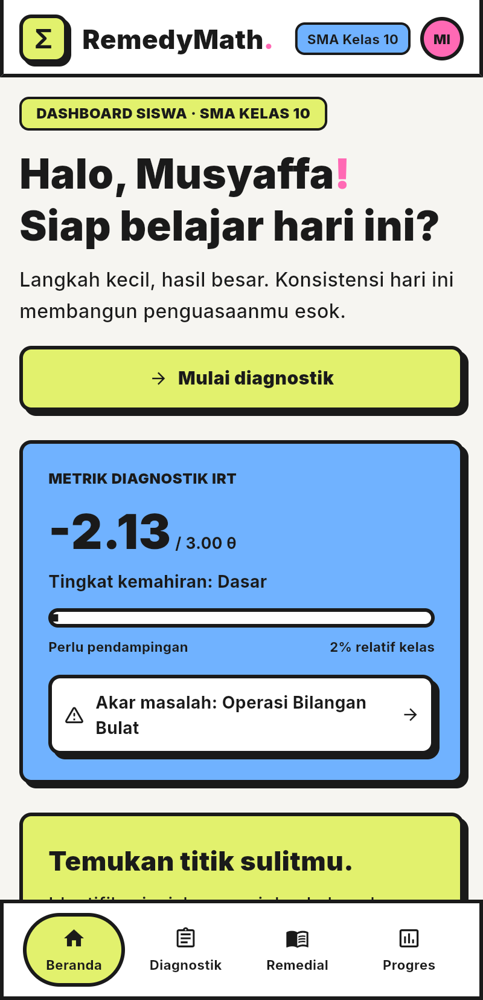
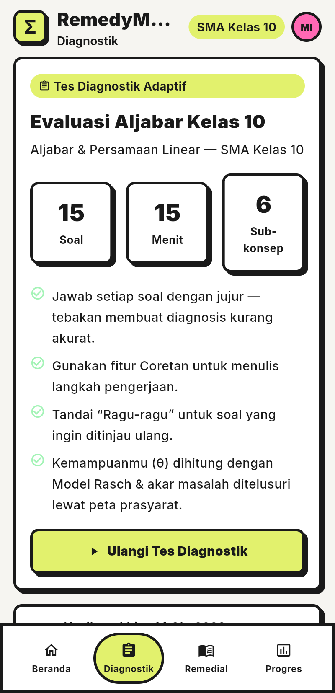
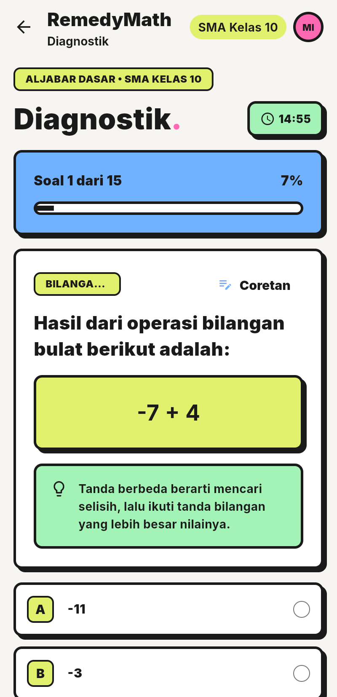
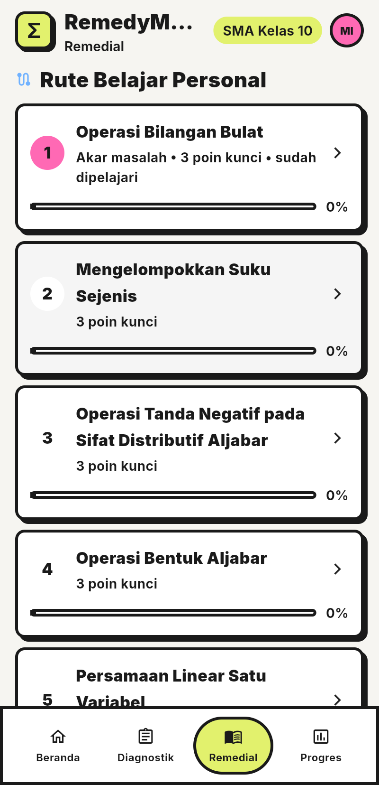
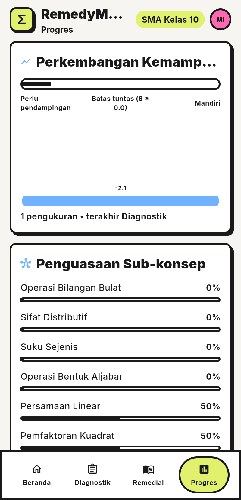

# RemedyMath

Aplikasi mobile Flutter: **Asisten Remediasi Matematika SMA berbasis Item
Response Theory (IRT) & Knowledge Graph**.

## Ringkasan Aplikasi

RemedyMath membantu siswa SMA kelas 10 menemukan **akar kelemahan** dalam
pembelajaran matematika, bukan sekadar melihat soal mana yang salah.
Aplikasi dimulai dari profil lokal sederhana (nama, kelas, asal sekolah),
lalu siswa mengerjakan **tes diagnostik adaptif 15 soal** dengan batas waktu.

Dari jawaban tersebut, aplikasi menghitung **skor kemampuan θ** dengan
Model Rasch 1PL dan iterasi Newton-Raphson (termasuk penanganan skor
ekstrem), lalu menelusuri **knowledge graph prasyarat materi** secara
mundur (*backward traversal*) untuk menemukan konsep paling dasar yang
belum dikuasai. Hasilnya berupa halaman **diagnosis** yang menampilkan θ,
peta kemampuan per konsep, akar masalah, dan rute belajar personal berupa
modul mikro-belajar (konsep inti + poin kunci) yang ditutup **post-test
ketuntasan**.

Seluruh alur berjalan **sepenuhnya offline** — tidak ada server, tidak ada
*dependency* eksternal untuk membuka tautan, dan seluruh progres
disimpan di perangkat lewat `shared_preferences`. Tampilan memakai gaya
**neobrutalism** (border tebal, bayangan ter-*offset*, warna aksen
berani) dengan tipografi Inter.

## Tangkapan Layar Antarmuka

| Beranda | Diagnostik |
|---|---|
|  |  |

| Kuis | Remedial |
|---|---|
|  |  |

| Progres |
|---|
|  |

## Langkah Menjalankan Proyek

### Prasyarat

- **Flutter 3.27.4** / **Dart 3.6.2** (lihat `pubspec.yaml`)
- Android Studio + **JDK 21** (AGP sudah disetel `8.2.2` di
  `android/settings.gradle` karena AGP < 8.2.1 bermasalah di Java 21)
- Perangkat Android atau emulator

### Instalasi & menjalankan

```bash
flutter pub get
flutter run
```

### Pemeriksaan & build

```bash
flutter analyze      # harus: No issues found!
flutter test         # unit test IRT, knowledge graph, kontras warna
flutter build apk --debug
```

APK hasil build ada di `build/app/outputs/flutter-apk/app-debug.apk`.

## Fitur

1. **Profil lokal** — nama, kelas, asal sekolah (disimpan di perangkat).
2. **Tes diagnostik** 15 soal pilihan ganda dengan batas waktu.
3. **Estimasi kemampuan (θ)** memakai Model Rasch 1PL + Newton-Raphson,
   termasuk penanganan skor ekstrem (semua benar → +2.0, semua salah → −2.0).
4. **Knowledge Graph prasyarat materi** — penelusuran mundur (*backward
   traversal*) untuk menemukan akar masalah, bukan sekadar soal yang salah.
5. **Rute belajar personal** — modul mikro-belajar (rumus inti + poin
   kunci) dan post-test ketuntasan adaptif.
6. **Riwayat sesi remedial & progres** tersimpan lokal.

## Struktur

```
lib/
  core/            tema, warna, tipografi, konstanta, util format
  models/          UserProfile, Question, ConceptNode, DiagnosticResult, ...
  services/        IrtService, KnowledgeGraphService, ContentRepository,
                   LocalStorageService
  controllers/     AppController (state global)
  views/pages/     Onboarding, RootShell, Dashboard, Diagnostik, Kuis,
                   Hasil Diagnosis, Remedial, Progres, Pembahasan
  views/widgets/   komponen UI yang dipakai ulang
assets/data/       questions.json, knowledge_graph.json
screenshots/       tangkapan layar antarmuka (untuk README ini)
test/              unit test IRT & Knowledge Graph
```

## Dokumentasi

Dokumentasi internal proyek (perencanaan, daftar tugas, riwayat perubahan,
hasil pengujian, dan katalog referensi desain) disimpan secara lokal dan
sengaja **tidak** dipublikasikan ke repositori ini. Ringkasan arsitektur
tercantum di bagian [Struktur](#struktur) dan
[Catatan desain](#catatan-desain).

## Catatan desain

- Semua layout memakai `Column`, `Row`, `Expanded`, `Wrap`,
  `ListView`/`SingleChildScrollView`, dan `LayoutBuilder` — tanpa lebar/tinggi
  besar yang dipaku, tanpa `Positioned` kaku.
- Target sentuh minimal 48dp. Palet dan tipografi terpusat di `lib/core/`.
- Ikon vektor dari desain diganti ikon bawaan Flutter (`Icons...`).
- Ambang ketuntasan default: **θ ≥ 0.0** (lihat `AppConstants.masteryTheta`)
  dan penguasaan sub-konsep **≥ 60%** (`AppConstants.masteryRatio`).
- Seluruh aplikasi berjalan offline tanpa izin jaringan; fitur video
  penjelasan dilepas agar tidak ada ketergantungan ke layanan eksternal.
